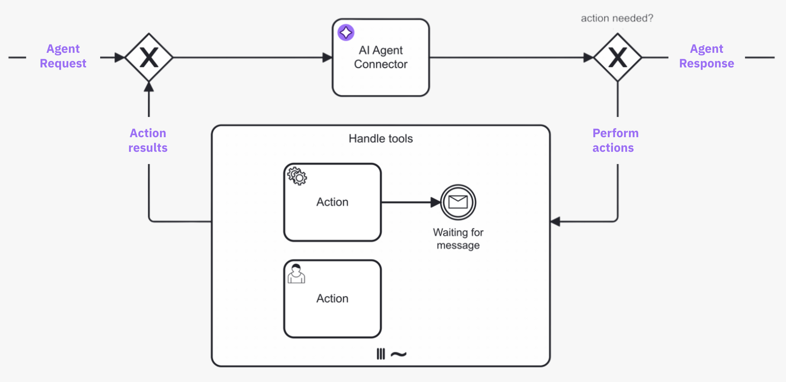

Understand how the AI Agent connector works, including prompts, tool descriptions, the agent loop, agent context, and response handling.

## System prompt, user prompt, and tool descriptions

Reliable agent behavior depends on three inputs working together:

- **System prompt**: Defines the agent's role, boundaries, priorities, and success criteria.
- **User prompt**: Carries the current request and immediate context.
- **Tool/task descriptions**: Define which actions are available in the ad-hoc sub-process and how each should be used.

At runtime, the connector passes this combined context to the LLM. The model then selects which tools to call (if any), along with parameters.

### How task descriptions are used for tools

When using an ad-hoc sub-process, each activity can be exposed as a tool. For best results, document each tool with:

- A clear task name that describes intent.
- A behavior-oriented description that includes when to use it, when not to use it, and the expected outcome.

This makes tool selection more predictable and reduces repeated or incorrect calls.

## Execution responsibility split

The decision and execution loop is shared between the LLM and Camunda:

- **LLM decides**: Which tool to call next, in what order, and with which parameters.
- **Camunda orchestrates**: Executes the selected BPMN activity, stores variables, applies retries and incident handling, and routes human tasks and events.

This means tools can be called in different orders, repeated, run in parallel, or skipped entirely, while execution remains constrained by the modeled process boundaries.

:::tip
For a broader overview of how execution works in an AI agent and architectural guidance, see [Design and architecture](/components/agentic-orchestration/design-architecture.md#how-execution-works-in-an-ai-agent).
:::

## Agent loop

This connector is typically used in an [agent loop](/reference/glossary.md#agent-loop), with the connector implementation repeatedly being executed based on tool call results until it is able to reach its goal. Each pass through the loop is a [loop iteration](/reference/glossary.md#loop-iteration).

For example, the following diagram shows an agent loop modeled with the [AI Agent Task](./agentic-ai-aiagent-task.md) implementation type.

- The process loops back to the AI Agent connector task from the ad-hoc sub-process until the agent decides no further tool calls are needed.
- With the [AI Agent Sub-process](./agentic-ai-aiagent-subprocess.md) implementation type, the agent loop is handled internally and so is not explicitly modeled in the BPMN diagram.



1. A request is made to the AI agent connector task, and the LLM determines what action to take.
1. If the AI agent decides that further action is needed, the process enters the ad-hoc sub-process and calls any tools deemed necessary to satisfactorily resolve the request.
1. The process loops back and re-enters the AI agent connector task, where the LLM decides (with contextual memory) if more action is needed before the process can continue. The process repeats this loop iteration until the AI agent decides it is complete, and passes the AI agent response to the next step in the process.

### Agent loop use cases

Typical agent loop use cases for this connector include the following:

| Use case             | Description                                                                                                                                                                                                                                                                                                                                                                                                                                                                                                                                                                                                                                                                                                                                                                                                                                                                                                 |
| :------------------- | :---------------------------------------------------------------------------------------------------------------------------------------------------------------------------------------------------------------------------------------------------------------------------------------------------------------------------------------------------------------------------------------------------------------------------------------------------------------------------------------------------------------------------------------------------------------------------------------------------------------------------------------------------------------------------------------------------------------------------------------------------------------------------------------------------------------------------------------------------------------------------------------------------------- |
| Tool calling         | <p>In combination with an ad-hoc sub-process, the AI Agent connector will resolve available tools and their input parameters, and pass these tool definitions to the LLM.</p><p><ul><li><p>The LLM generates a response, that might include tool calls (a request to call a tool paired with the input parameters).</p></li><li><p>If tool calls are requested, the tools can be executed by activating the respective activities within the ad-hoc sub-process.<ul><li>With the [AI Agent Sub-process](./agentic-ai-aiagent-subprocess.md) implementation, activating the activities will be implicitely handled by the agent implementation.</li><li>With the [AI Agent Task](./agentic-ai-aiagent-task.md) implementation, it is necessary to model the process to pass these tool calls to the ad-hoc sub-process and to return the tool call results to the AI Agent task.</li></ul></p></li></ul></p> |
| Response interaction | After returning a response (and without calling any tools), model the process to act upon the response. For example, present the response to a user who can then ask follow-up questions back to the AI Agent connector as a [human-in-the-loop (HITL)](/reference/glossary.md#human-in-the-loop-hitl) follow-up.                                                                                                                                                                                                                                                                                                                                                                                                                                                                                                                                                                                           |

As the agent preserves the context of the conversation, follow-up questions/tasks and handling of tool call results can
relate to the previous interaction with the LLM, allowing the LLM to provide more relevant responses.

## Response follow-up

Separately from the agent loop's own tool calling, the AI Agent connector's response can also be reviewed before the process continues: the process routes the agent's response to a task, such as a user task or another LLM acting as a judge, and can be modeled to loop back and re-enter the agent with a follow-up request. When that reviewing task is a person, this is an example of [human-in-the-loop (HITL)](/reference/glossary.md#human-in-the-loop-hitl). This pattern is distinct from the agent loop itself, which is the LLM's internal tool-calling cycle rather than an external re-invocation of the process.

For worked examples, see the [AI Agent Sub-process example](./agentic-ai-aiagent-subprocess-example.md) and the [AI Agent Task example](./agentic-ai-aiagent-task-example.md).

## Agent context

An important concept to understand is the use of the **Agent context** process variable to store information required for allowing re-entry to the AI Agent connector task with the same context as before.

Depending on which implementation type is used, the Agent context must be configured differently in the model:

- [**AI Agent Sub-process**](./agentic-ai-aiagent-subprocess.md): The agent context is kept within the sub-process scope. This means you only need to configure the agent context when the agent should pick up an existing conversation, for example to model a [human-in-the-loop (HITL)](/reference/glossary.md#human-in-the-loop-hitl) follow-up as in the [quickstart example](../../../guides/getting-started-agentic-orchestration.md). In this case, you must align the configured agent context variable with the used result variable/expression so that the context update is correctly passed to the next execution of the AI Agent connector task.

- [**AI Agent Task**](./agentic-ai-aiagent-task.md): You must align the agent context input variable and the response variable/expression so the context update is correctly passed to the next execution of the AI Agent connector task.

## Response format {#response}

The AI Agent connector can be configured to instruct the LLM to respond in a structured JSON format, and to parse the JSON structure into a FEEL context accordingly. This allows the LLM to return structured data that can be easily processed in the BPMN process.

## Example conversation

The following is a high-level example conversation with the AI Agent connector, including both an agent loop and a human-in-the-loop (HITL) follow-up.

The conversational awareness provided by the agent context allows use cases such as the user only responding with `Yes, please proceed`, with the agent understanding what it should do next.

```
# Initial input/user prompt
User: Is John Doe eligible for a credit card?

# Agent loop
AI Agent: Call the `Check_Credit_Card_Eligibility` tool with the following parameters: {"name": "John Doe"}
<process routes through ad-hoc sub-process>
Tool Call Result: {"Check_Credit_Card_Eligibility": {"eligible": true}}

# Human-in-the-loop (HITL) follow-up
AI Agent: John Doe is eligible for a credit card. Would you like to proceed?
<process routes to a user task as no tool calls are requested>
User: Yes, please proceed.

AI Agent: Call the `Create_Credit_Card` tool with the following parameters: {"name": "John Doe"}
Tool Call Result: {"Create_Credit_Card": {"success": true}}

AI Agent: John Doe's credit card has been created successfully.
```
