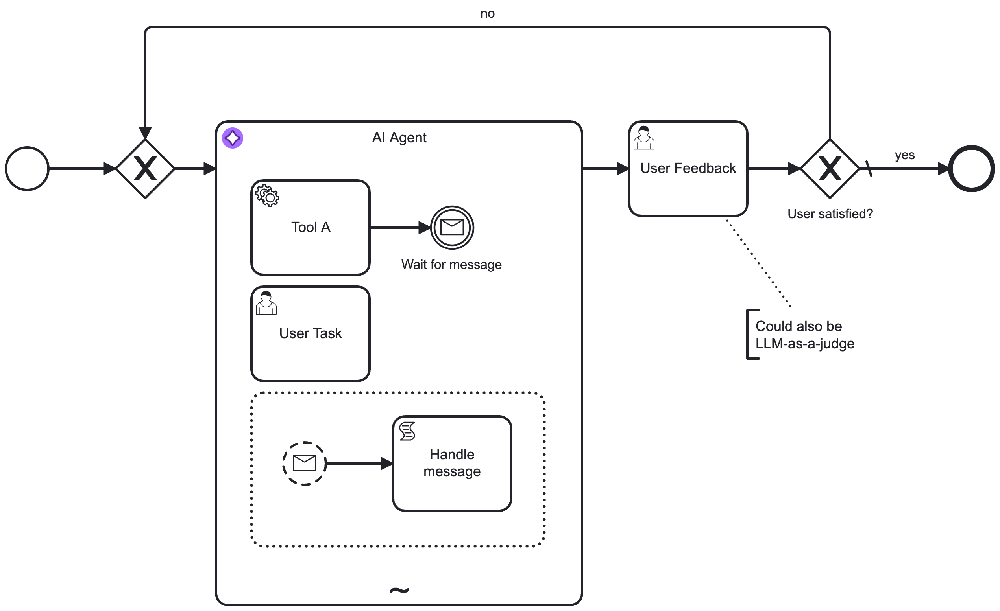

import ConfigurationSystemPrompt from './agentic-ai/aiagent/configuration/\_system-prompt.md';
import ConfigurationUserPrompt from './agentic-ai/aiagent/configuration/\_user-prompt.md';
import ConfigurationMemoryProcess from './agentic-ai/aiagent/configuration/\_memory-process.md';
import ConfigurationLimits from './agentic-ai/aiagent/configuration/\_limits.md';
import ConfigurationEventHandling from './agentic-ai/aiagent/configuration/\_event-handling.md';
import ConfigurationResponse from './agentic-ai/aiagent/configuration/\_response.md';
import ConfigurationOutputMappingProcess from './agentic-ai/aiagent/configuration/\_output-mapping-process.md';
import ConfigurationErrorHandling from './agentic-ai/aiagent/configuration/\_error-handling.md';
import ConfigurationRetries from './agentic-ai/aiagent/configuration/\_retries.md';
import ConfigurationExecutionListeners from './agentic-ai/aiagent/configuration/\_execution-listeners.md';
import AgentProcessImg from '../img/ai-agent-subprocess.png';

Implement an AI agent using an ad-hoc sub-process with an applied AI Agent connector template.

## About this implementation

This connector implementation creates an implicit [agent loop](/reference/glossary.md#agent-loop) for tool calls and agent responses, using the [job worker implementation type](../../../components/modeler/bpmn/ad-hoc-subprocesses/ad-hoc-subprocesses.md#job-worker-implementation) of an [ad-hoc sub-process](../../../components/modeler/bpmn/ad-hoc-subprocesses/ad-hoc-subprocesses.md). It handles tool resolution and the agent loop automatically.

This is the recommended implementation for most use cases, and offers:

- Simplified configuration as the agent loop is handled internally.
- Support for handling of event sub-processes within the ad-hoc sub-process. See [event handling](#event-handling).

:::info
The [example integration](agentic-ai-aiagent-subprocess-example.md) outlines how to model an agentic AI process using the AI Agent Sub-process implementation.
:::

A basic AI Agent Sub-process might look similar to the following example. The connector is configured so the AI agent resolves available tools and activates them as needed to complete its goal.

### Combine with a response follow-up

You can combine this pattern with a response follow-up for verification or follow-up interactions. For example, instead of the user task shown in the following diagram, you can use another LLM acting as a judge, or any other task that validates the agent's response.

## Configuration

### Model provider

Select the LLM model **Provider** and **Model**. See [model providers](./agentic-ai-aiagent-model-providers.md) for supported providers and configuration details.

<ConfigurationSystemPrompt />
<ConfigurationUserPrompt />
<ConfigurationMemoryProcess />
<ConfigurationLimits />
<ConfigurationEventHandling />
<ConfigurationResponse type="process" />
<ConfigurationOutputMappingProcess />
<ConfigurationErrorHandling type="process" />
<ConfigurationRetries />
<ConfigurationExecutionListeners />

## Limitations

- Because of BPMN semantics, the ad-hoc sub-process must contain at least one activity. This means you cannot create an AI Agent Sub-process without any tools.
- As the agent loop is implicitly handled within the AI Agent execution, you have less control over the tool calls.
