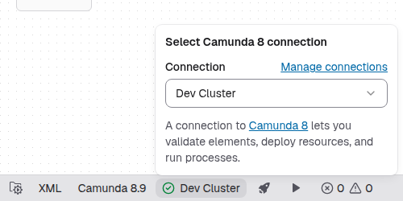
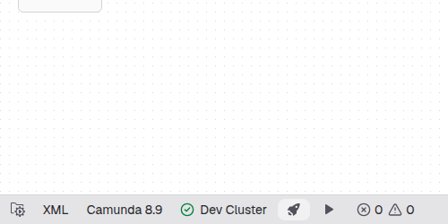
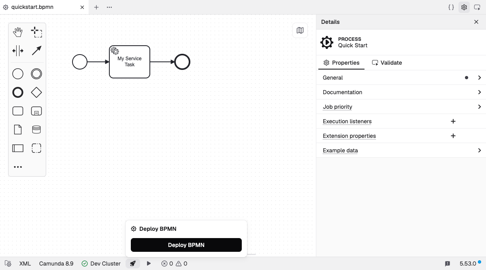
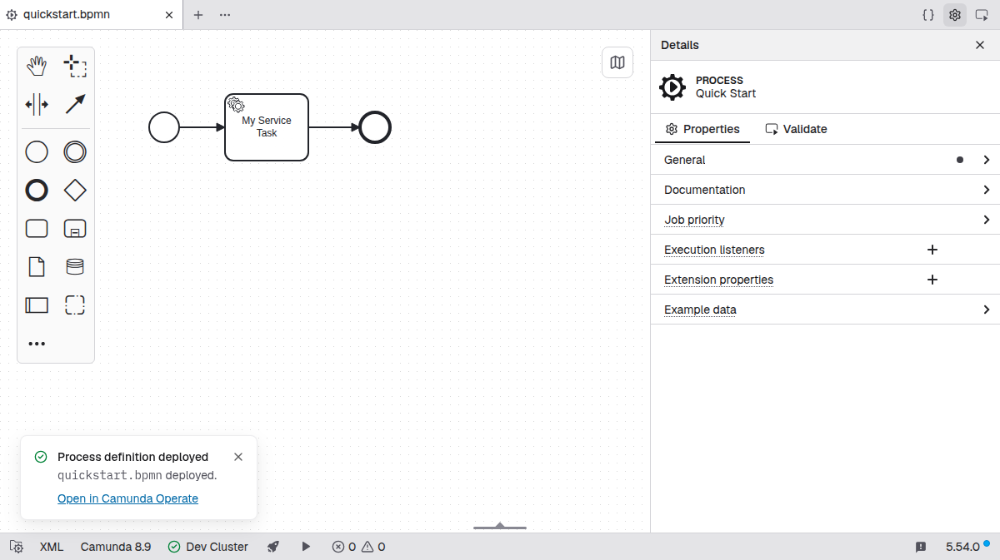

Deploy a diagram from Desktop Modeler to Camunda 8. You need a diagram open in the editor.

1. Set up and select a connection by following [Connect to Camunda 8](./connect-to-camunda-8.md).

   

2. Click the **Deploy** icon:

   

3. Click **Deploy** to perform the actual deployment.

   

4. If the deployment is successful, Desktop Modeler shows a confirmation message:

   

## Next steps

- [Start a new process instance](./start-instance.md)
- [Deploy a project](./work-with-projects.md#deploy-a-project)
