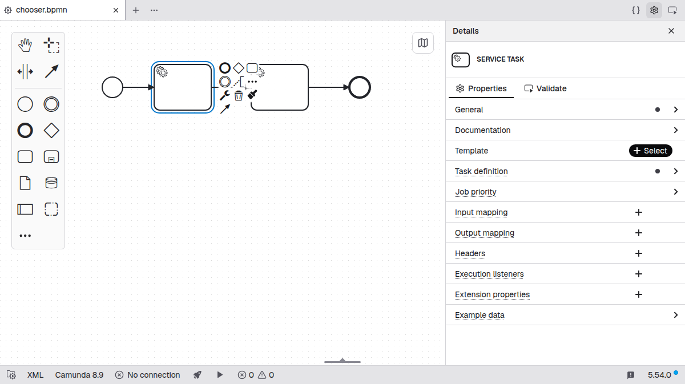
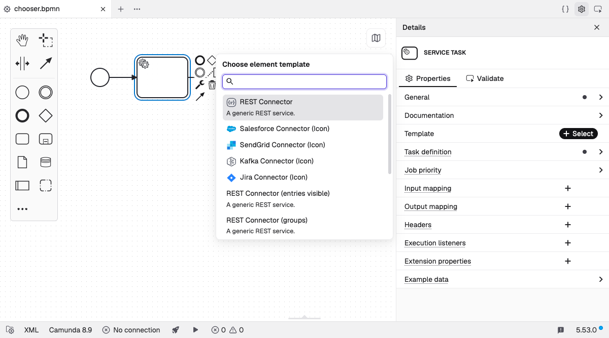
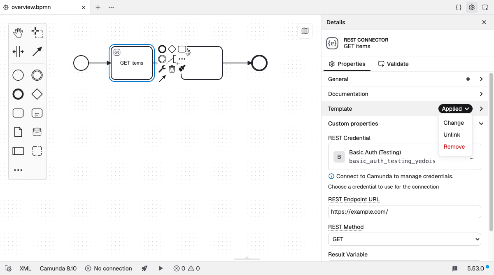
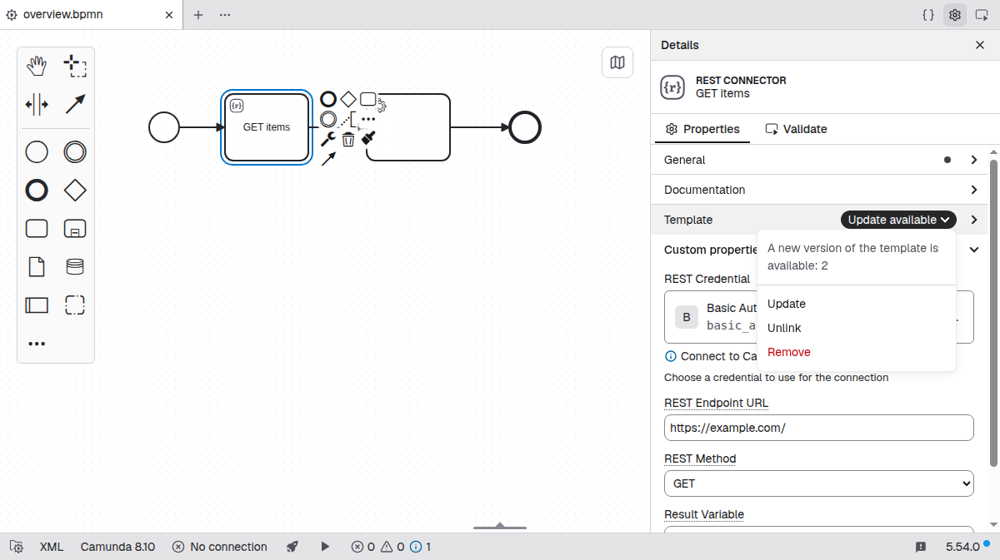
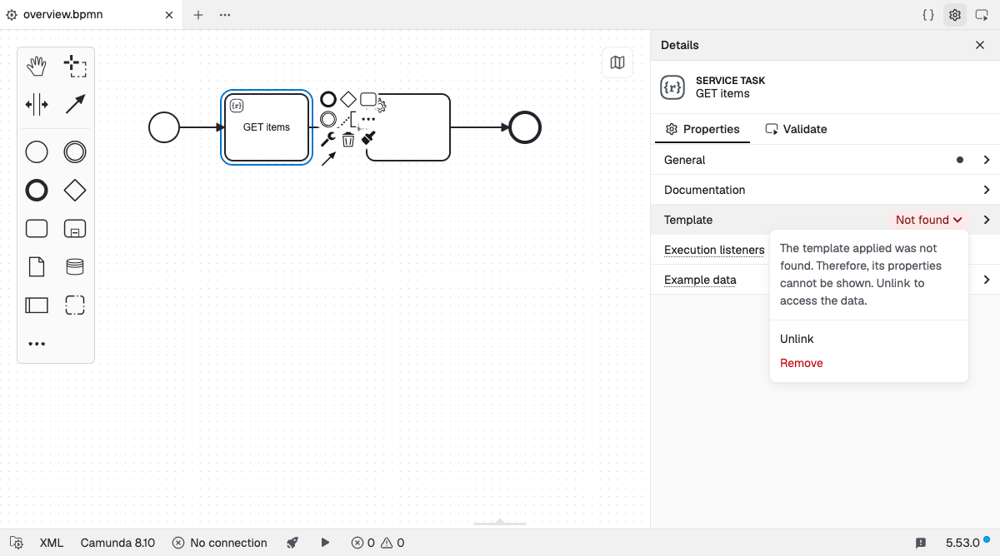

## Applying templates

If an [element template](/components/modeler/element-templates/about-templates.md) matches a selected diagram element, the template catalog button is shown in the properties panel on the right side of the screen.



Clicking **Select** opens a popup menu, allowing you to browse and search available templates for the
selected element.



Applying a template stores it via the `modelerTemplate` property and the optional `modelerTemplateVersion` property
on the selected element:

```xml

<bpmn:serviceTask id="MailTask"
                  zeebe:modelerTemplate="com.mycompany.MailTask"
                  zeebe:modelerTemplateVesion="1"/>
```

It also sets up custom fields on the diagram element and makes these available for inspection and editing.
Properties which were not configured in the element template using custom fields will not be available for editing.

### Applying a template that defines operations

Templates that define [operations](/components/modeler/element-templates/template-metadata.md#predefined-configurations-steps-and-presets) — for example, a connector template for a service with several operations — show their operations in the popup menu instead of applying the template directly. Select an operation to apply the template with that operation preselected, then complete the remaining fields in the properties panel.

Operations are also matched by search, so you can search for the action you want to perform, such as `upload object`, without knowing which template provides it. Search matches an operation's name, description, and keywords together with those of its parent operations and its template.

## Removing templates

To remove an applied template from an element, either the _Unlink_ or _Remove_ function can be used:

- **Remove**: Remove the element template from the `modelerTemplate` property and reset all properties of the respective element.
- **Unlink**: Remove the element template from the `modelerTemplate` property but keep the properties which were set.



## Updating templates

If a template is applied and a new version of the template is found you can _update_ the template.



Templates are updated according to the following rules:

- If the property is set in the new template, it will override the existing value — unless the value was originally set by the old template and has been manually changed since.
- If the property is not defined in the new template, it will unset.
- Sub-properties of complex properties (for example, `zeebe:input`, `zeebe:output`) are handled
  according to these rules if they can be identified.
- Values are moved to new bindings, as the template's update paths declare.

To learn what changes before you update, select **Review changes**, if available.

### Migrating templates

If a different template supersedes the applied one, the properties panel shows **Migration available**. Select **Migrate** to change the element to the new template, moving its values as the template declares. To learn what changes before you migrate, select **Review changes**, if available.

After migrating, review the configuration. The properties panel highlights values that you need to provide or correct.

### Replacing templates

If a template is deprecated in favor of a different template, replace it: select the element, open the **Change element** menu, and select the new template. Values of compatible properties are kept. Review the remaining configuration, and follow the hints in the deprecation message.

## Missing templates

If a template is applied to an element but the respective template cannot be found on the system, the editing of the
element is disabled. _Unlinking_ or _removing_ the template for the element or adding the element template config
enables the editing again.


