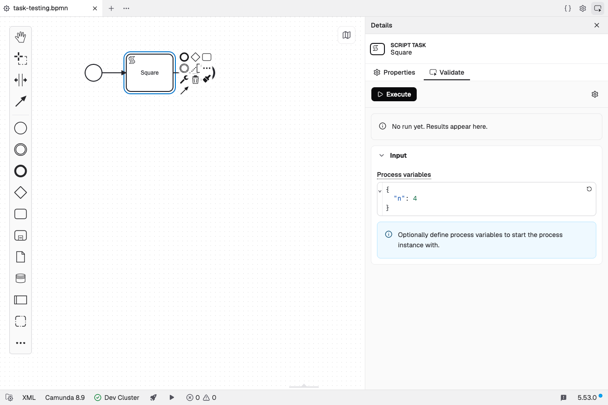
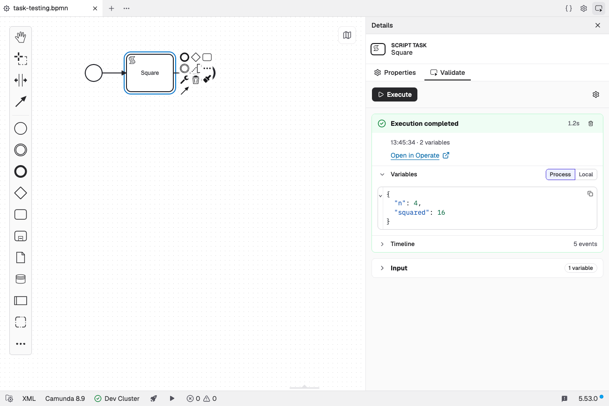
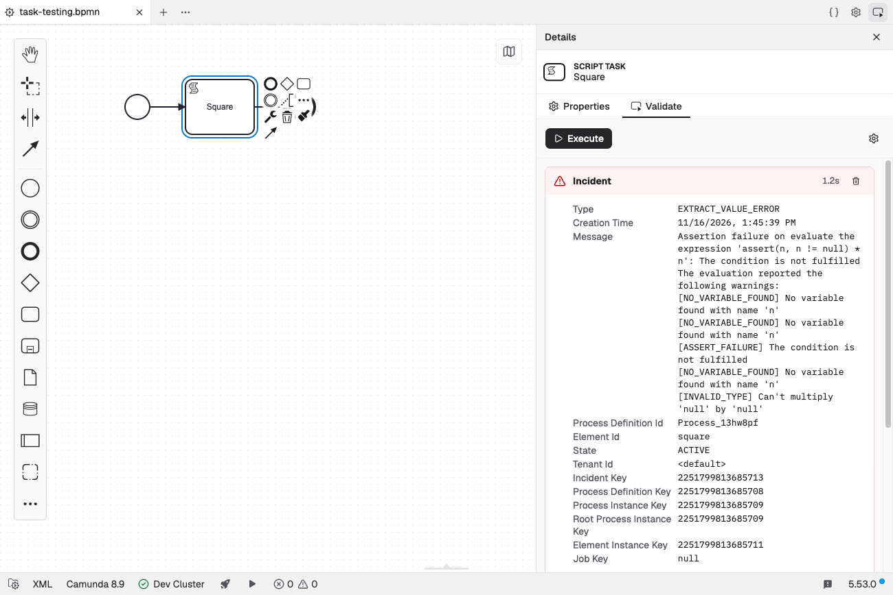

[Validate a single element](../element-validation.md) in Desktop Modeler to quickly verify its logic, variable mappings, and configuration—without running the entire process.

Element validation deploys the process and executes the selected element on the engine, as if it would be executed in a process flow. You control the context (process variables) that can verify if the outputs match your expectation.

## Prerequisites

Element validation requires a **REST connection** to a Camunda instance running 8.8.0+.
gRPC connections are not supported.

You can set up a connection by following the [Connect to Camunda 8](./connect-to-camunda-8.md) guide.

## Validate an element

1. Select the element you want to validate.
2. Open the **Validate** tab in the side panel.

### Process variables

Under **Input**, define the [process variables](../../concepts/variables.md), the context the element will be executed in.

As you type, the editor provides autocompletion for variables available in scope, including those generated by previous executions.

### Execution

Click **Execute** to run the selected element.

Your BPMN diagram will be saved, deployed, and a process instance will start automatically.

:::note
If you're working in a [project](./projects.md), all its resources will be deployed along with the process.
:::

Once the process instance starts, a link to view it in Operate is provided.  
The **Validate** tab waits for the element to complete or for an incident to occur. Click **Cancel** to stop waiting. The process instance keeps running on the cluster.

## Results

An execution can result in any of the following outcomes:

### Successful execution

When the element completes successfully, the results panel displays the process variables _after_ execution. This includes variables created by the element, mapped through defined output mappings.

### Incident

If an incident occurs during execution, you’ll see its details along with the process variables.

### Error

If the execution fails due to an error, the response message is displayed.

## Related

- [Element validation in Camunda Hub](../../hub/workspace/modeler/validation/element-validation.md)
- [Learn how element validation works](../element-validation.md)
- [Working with variables](../../concepts/variables.md)
