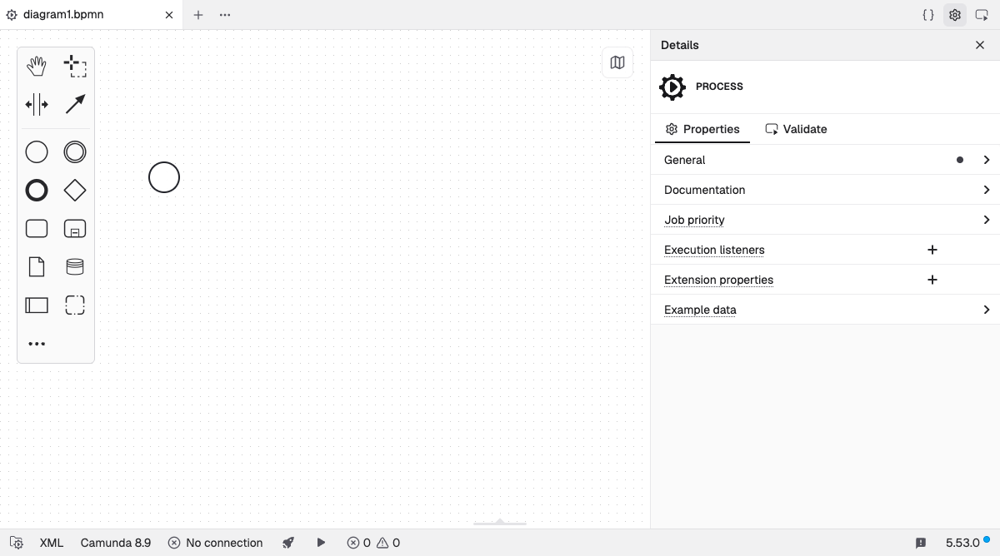

Camunda 7 and 8

Desktop Modeler (also known as Camunda Modeler) is a desktop application for modeling BPMN, DMN, and Forms. As part of the Camunda implementation toolkit, it helps you create executable diagrams while working alongside your preferred IDE, integrated into your professional software development environment.

## What you can do with Desktop Modeler

- Design [BPMN](../bpmn/bpmn.md), [DMN](../dmn/dmn.md), and [Forms](../forms/camunda-forms-reference.md)
- Implement process applications for Camunda 7 and 8
- Deploy and run processes directly from the application
- Validate your diagrams using [configurable lint rules](./custom-lint-rules/custom-lint-rules.md)
- [Customize](./flags/flags.md) and [extend](./plugins/plugins.md) the application
- Work against the local file system

## Find what you need

| If you want to…                               | Go to                                                                                                                                                        |
| --------------------------------------------- | ------------------------------------------------------------------------------------------------------------------------------------------------------------ |
| Learn by building something                   | [Model your first diagram](./model-your-first-diagram.md) and [Build and deploy your first form](./utilize-forms.md)                                         |
| Complete a specific task                      | [Install](./install-the-modeler.md), [connect](./connect-to-camunda-8.md), [deploy](./deploy-diagram.md), [start an instance](./start-instance.md), and more |
| Look up settings, flags, paths, or telemetry  | [Settings](./settings/settings.md), [flags](./flags/flags.md), [search paths](./search-paths/search-paths.md), [telemetry](./telemetry/telemetry.md)         |
| Understand how Desktop Modeler organizes work | [Projects in Desktop Modeler](./projects.md)                                                                                                                 |
| Fix a problem                                 | [Troubleshoot Desktop Modeler](./troubleshooting.md)                                                                                                         |

## Get started

1. [Install Desktop Modeler](./install-the-modeler.md) from the [Camunda downloads page](https://camunda.com/download/modeler/).
1. [Model your first diagram](./model-your-first-diagram.md).
1. [Connect to Camunda 8](./connect-to-camunda-8.md) and [deploy your diagram](./deploy-diagram.md).

## Resources

- [Report an issue](https://github.com/camunda/camunda-modeler/issues)
- [Source code](https://github.com/camunda/camunda-modeler)
