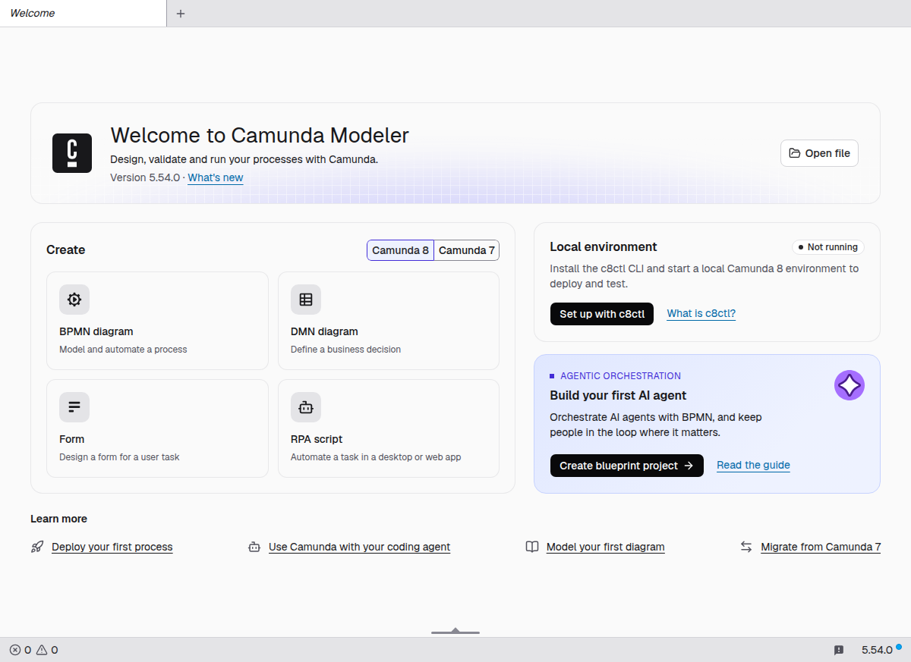
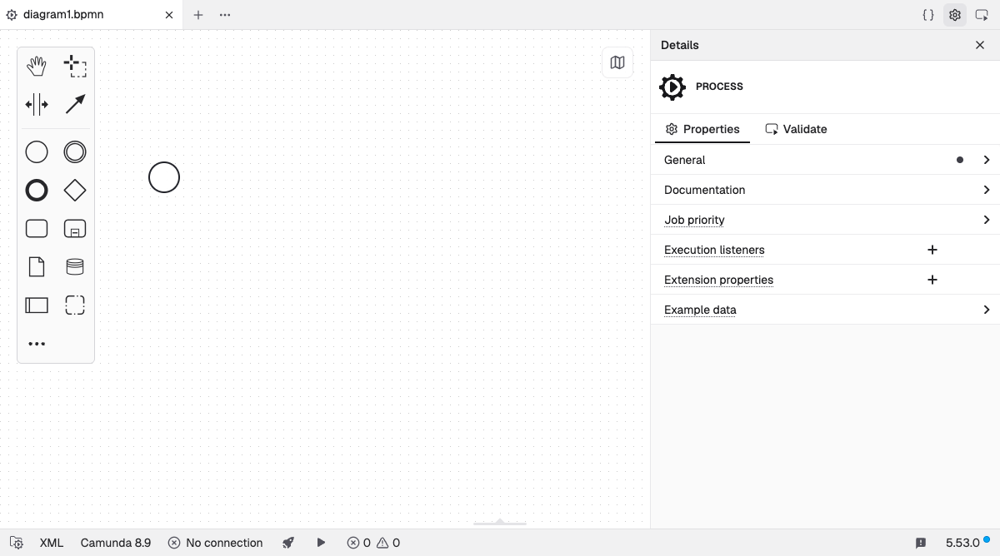
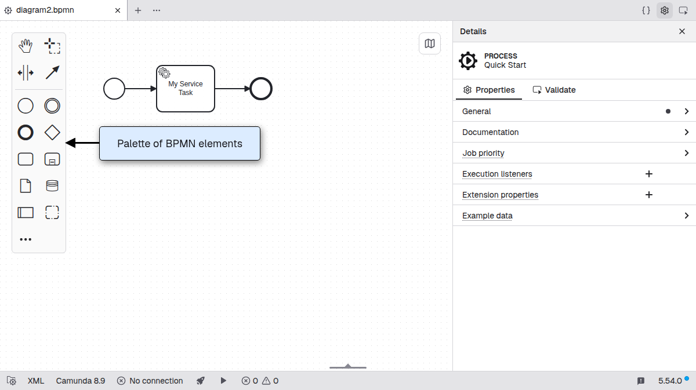
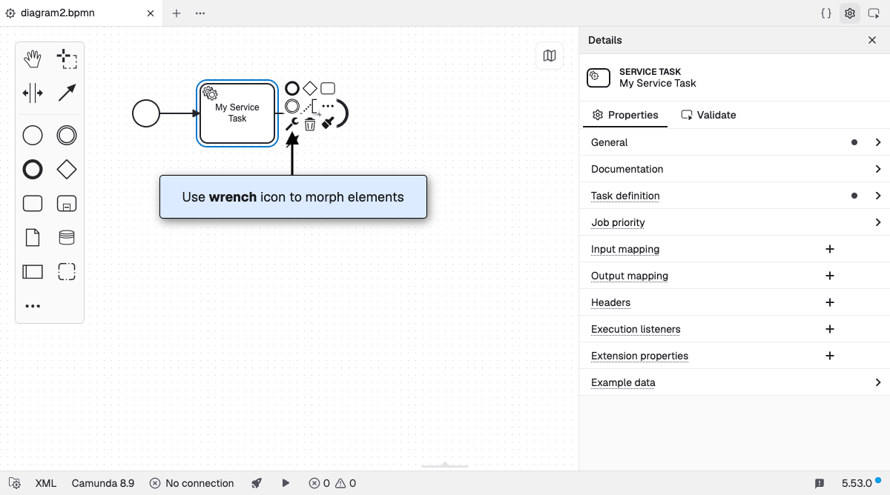
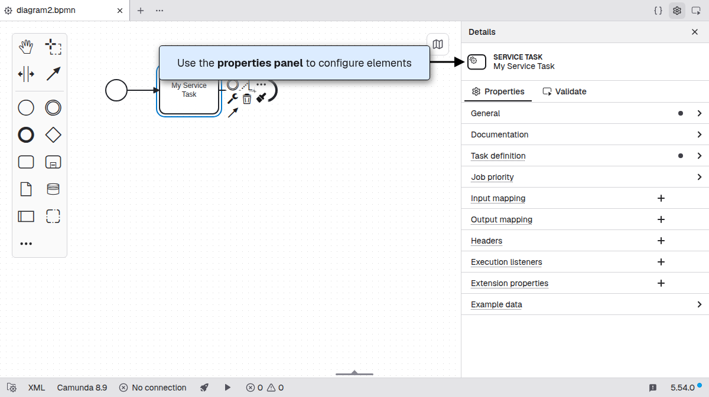

Beginner

In this tutorial, you model a simple BPMN process with a start event, a service task, and an end event, and save it to your computer. You need [Desktop Modeler installed](./install-the-modeler.md).

## Create the diagram

1. Start Desktop Modeler and select **BPMN diagram**.

   

   The diagram opens with a start event. A [start event](/components/modeler/bpmn/events.md) marks where a process begins.

   

1. Click the start event and select the rectangular task icon. Desktop Modeler creates a [task](/components/modeler/bpmn/tasks.md) after the start event, connected by an arrow.
1. Double-click the task and enter a name, for example `My Service Task`.
1. Click the task and select the dark circle in the top left. Desktop Modeler attaches an end event to the task.

   You can also drag elements from the palette on the left side of the screen onto the canvas.

   

## Change the task type

1. Click the task and select the **Change element** (wrench) icon.
1. Select **Service task**.

   

The task is now a [service task](../bpmn/service-tasks/service-tasks.md).

## Edit element properties

1. Open the properties panel by selecting the light gray arrow on the right side of the page, halfway down the canvas.
1. Select the service task. In the **General** section, enter a name and an ID.

   

## Save the diagram

Select **File > Save**, **File > Save As**, or press `Cmd + S` (macOS) or `Ctrl + S` (Windows and Linux). Desktop Modeler saves the file to the location you choose on your local file system. It doesn't store diagrams in a separate internal workspace. To find the file again, reopen it from that folder or from the recent files list on the start screen.

## Next steps

- [Connect to Camunda 8](./connect-to-camunda-8.md) and [deploy your diagram](./deploy-diagram.md).
- [Build and deploy your first form](./utilize-forms.md).
- Review the [supported BPMN elements](/components/modeler/bpmn/bpmn-coverage.md) or [orchestrate human tasks](/guides/getting-started-orchestrate-human-tasks.md).
