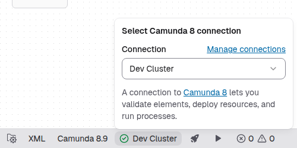
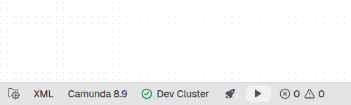
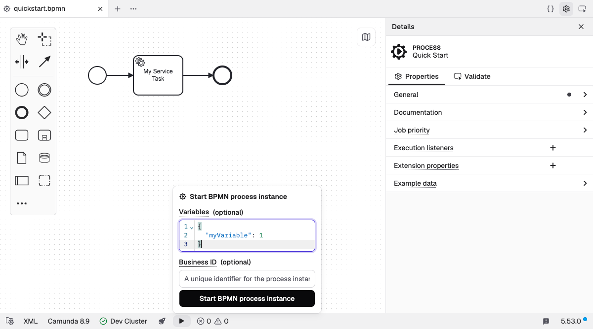
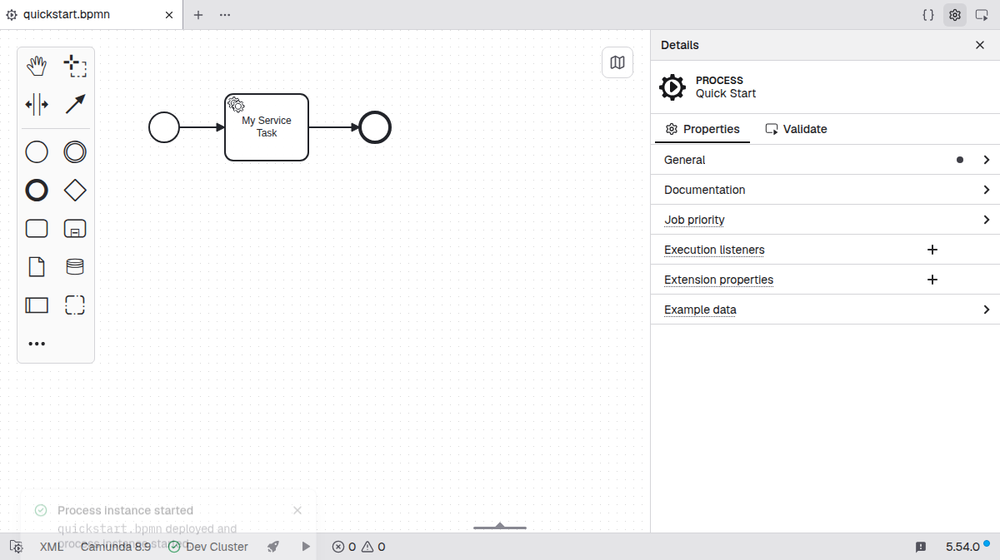

Start a new instance of a process from Desktop Modeler after you deploy it to Camunda 8.

1. Select a connection by following [Connect to Camunda 8](./connect-to-camunda-8.md).

   

2. Click the play icon to start a new process instance.

   

3. (Optional) Enter variables for the process instance. Click **Start BPMN process instance** to deploy and start the instance.

   

   Desktop Modeler shows a confirmation message when the instance starts.

   
