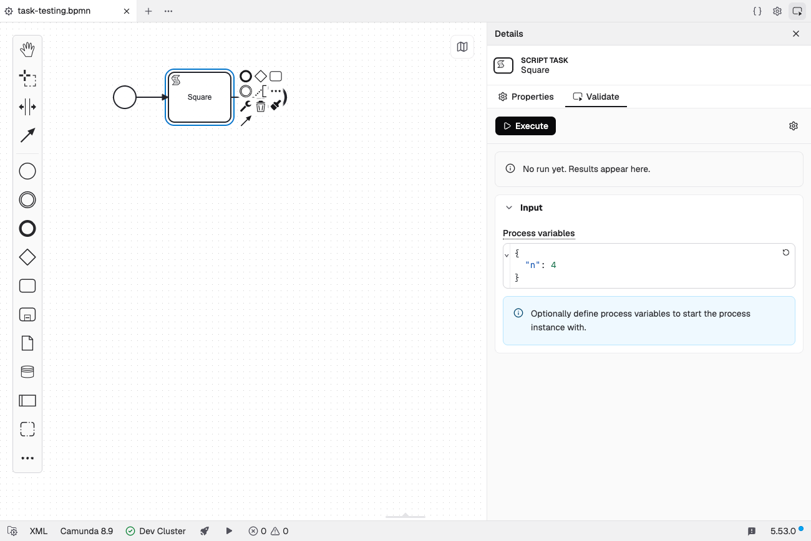
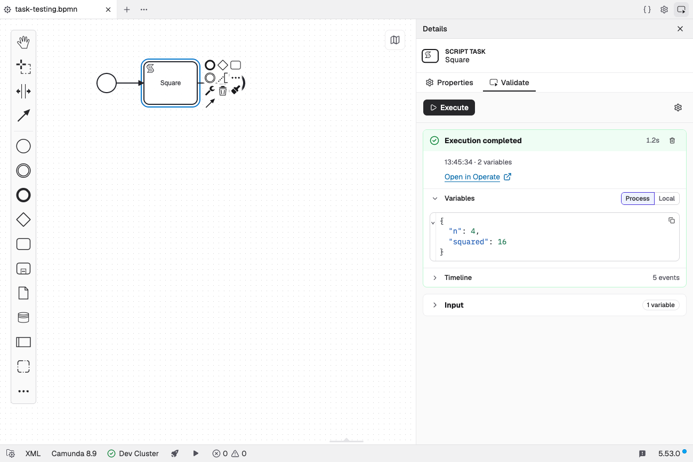
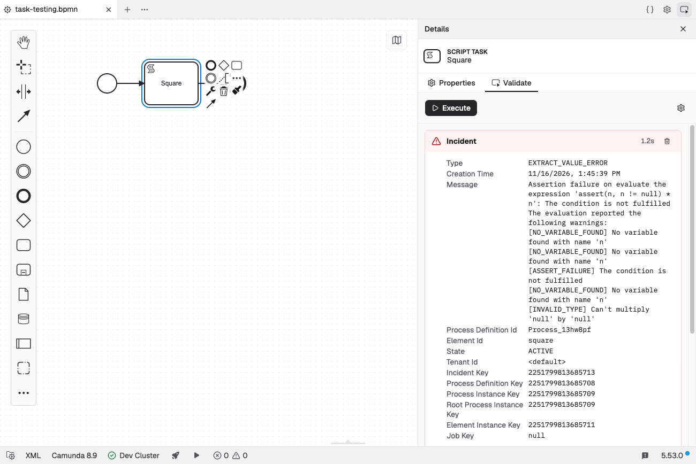

Test a single task in Desktop Modeler to verify its logic, variable mappings, and configuration without running the entire process. To learn how task testing works, see [task testing concepts](../task-testing.md).

## Prerequisites

- A **REST connection** to a Camunda instance running 8.8.0+. gRPC connections are not supported. See [Connect to Camunda 8](./connect-to-camunda-8.md).

## Test a task

1. Select the task you want to test.
2. Open the **Task testing** tab in the bottom panel.

### Define process variables

In the left pane, define the [process variables](../../concepts/variables.md) that provide the context for the task. The editor autocompletes variables in scope, including those from previous task testing runs.

### Run the test

Click **Test task**. Desktop Modeler saves and deploys your BPMN diagram, then starts a process instance automatically.

If you work in a [project](./projects.md), Desktop Modeler deploys all its resources along with the process.

When the instance starts, Desktop Modeler shows a link to view it in Operate, and waits for the task to complete or for an incident to occur.

## Interpret test results

A test run has one of the following outcomes:

### Successful execution

When the task completes successfully, the results panel displays the process variables _after_ execution. This includes variables created by the task, mapped through defined output mappings.

### Task incident

If an incident occurs, Desktop Modeler shows its details along with the process variables.

### Error

If the task fails with an error, Desktop Modeler shows the response message.

## Related topics

- [Test a task in Camunda Hub](../../hub/workspace/modeler/validation/task-testing.md)
- [Learn about task testing concepts](../task-testing.md)
- [Working with variables](../../concepts/variables.md)
