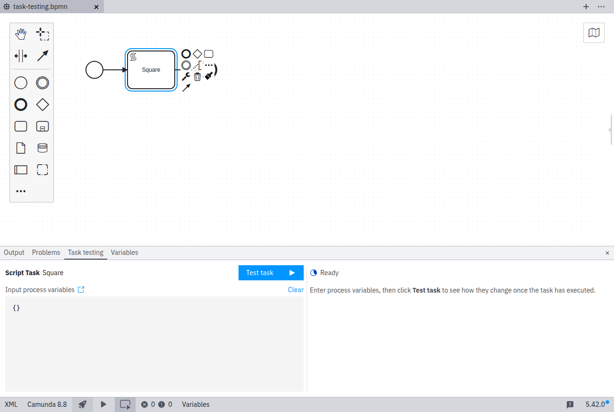
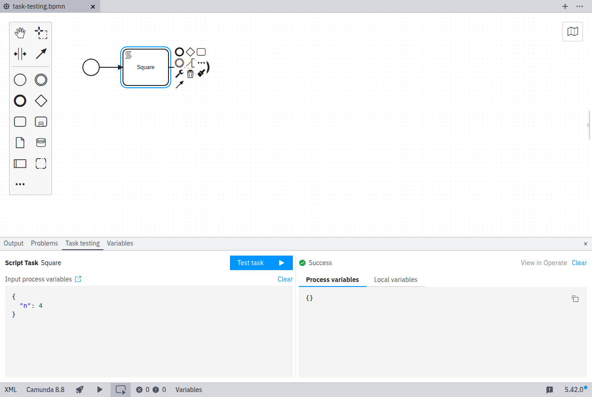
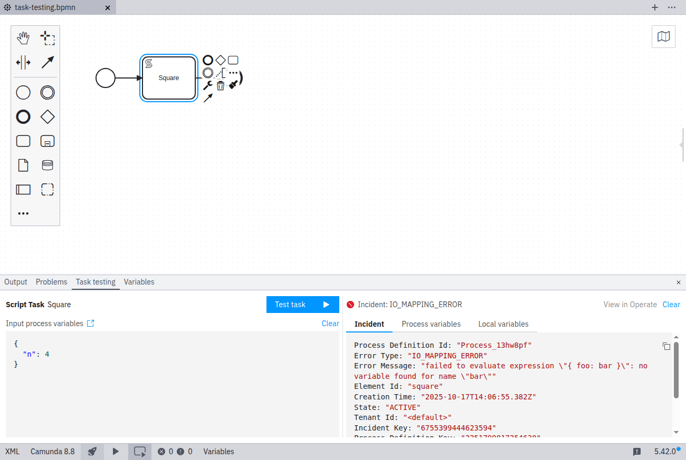

[Validate a single task](../task-testing.md) in Desktop Modeler to quickly verify task logic, variable mappings, and configuration—without running the entire process.

Validating deploys the process and executes the selected task on the engine, as if it would be executed in a process flow. You control the context (process variables) that can verify if the outputs match your expectation.

## Prerequisites

Validating requires a **REST connection** to a Camunda instance running 8.8.0+.
gRPC connections are not supported.

You can set up a connection by following the [Connect to Camunda 8](./connect-to-camunda-8.md) guide.

## Validate a single activity

1. Select the task you want to validate.
2. Open the **Validate** tab in the side panel.

### Process variables

Under **Input**, define the [process variables](../../concepts/variables.md), the context the task will be executed in.

As you type, the editor provides autocompletion for variables available in scope, including those generated by previous executions.

### Task execution

Click **Execute** to run the selected activity.

Your BPMN diagram will be saved, deployed, and a process instance will start automatically.

:::note
If you're working in a [project](./projects.md), all its resources will be deployed along with the process.
:::

Once the process instance starts, a link to view it in Operate is provided.  
The **Validate** tab waits for the task to complete or for an incident to occur. Click **Cancel** to stop waiting. The process instance keeps running on the cluster.

## Results

An execution can result in any of the following outcomes:

### Successful execution

When the task completes successfully, the results panel displays the process variables _after_ execution. This includes variables created by the task, mapped through defined output mappings.

### Task incident

If an incident occurs during execution, you’ll see its details along with the process variables.

### Error

If the task execution fails due to an error, the response message is displayed.

## Related

- [Validate a task in Camunda Hub](../../hub/workspace/modeler/validation/task-testing.md)
- [Learn how Validate works](../task-testing.md)
- [Working with variables](../../concepts/variables.md)
