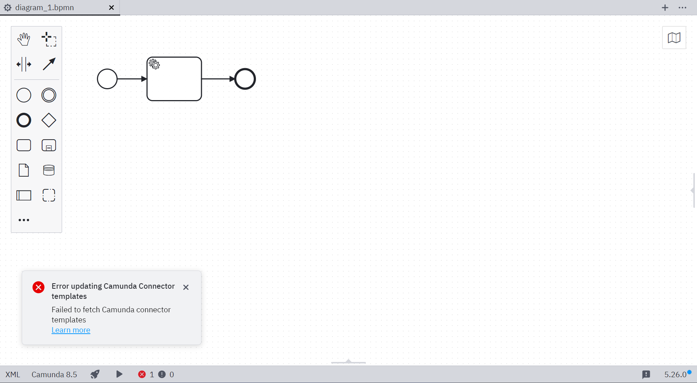
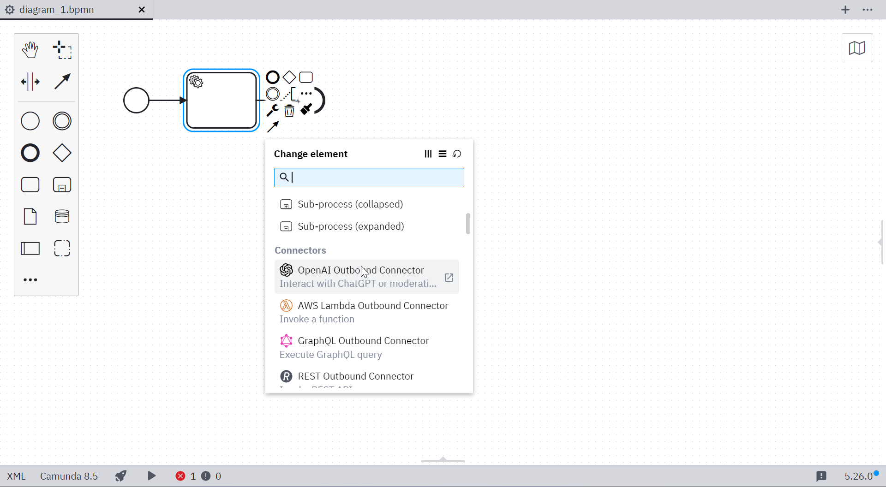

Camunda 8 only

Use [Camunda 8 connectors](../../connectors/introduction.md) to access a growing range of external services or communication protocols.

Desktop Modeler includes a built-in element template source, **Camunda connectors**, that provides templates for [pre-built connectors](../../connectors/out-of-the-box-connectors/available-connectors-overview.md) from the [Camunda Marketplace](https://marketplace.camunda.com/en-US/listing?pl=3038&attr=20486&cat=107792&locale=en-US). You can enable or disable it in **Settings > Element template sources**. You can also [configure custom element template sources](./element-templates/configuring-templates.md#remote-template-sources).

## Automatic connector template fetching

The built-in **Camunda connectors** source is enabled by default. Desktop Modeler checks it when you import a diagram into the editor or change the diagram's Camunda execution platform version.

Desktop Modeler does not show a notification when the source has no new templates. It notifies you when new templates are available or when it cannot retrieve or process a source or template. If a fetch fails, cached templates remain available.

Once available, you can use connector templates in the Camunda 8 BPMN editor.

## Disable automatic connector template fetching

Disable the built-in Camunda connector source using its toggle in **Settings > Element template sources**. The [`disable-connector-templates` flag](./flags/flags.md#disable-connector-templates) overrides the toggle and locks the built-in source setting. Custom sources are not affected.

## Add connector templates manually

To add connector templates from the filesystem, use the [global template search paths](./element-templates/configuring-templates.md#global-templates).

## Additional resources

- [About Camunda 8 connectors](../../connectors/out-of-the-box-connectors/available-connectors-overview.md)
- [About element templates](/components/modeler/element-templates/about-templates.md)
- [Desktop Modeler flags](./flags/flags.md#disable-connector-templates)
