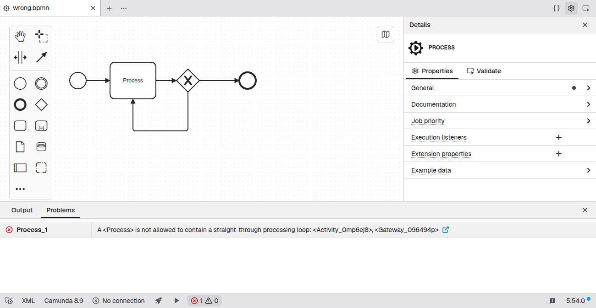
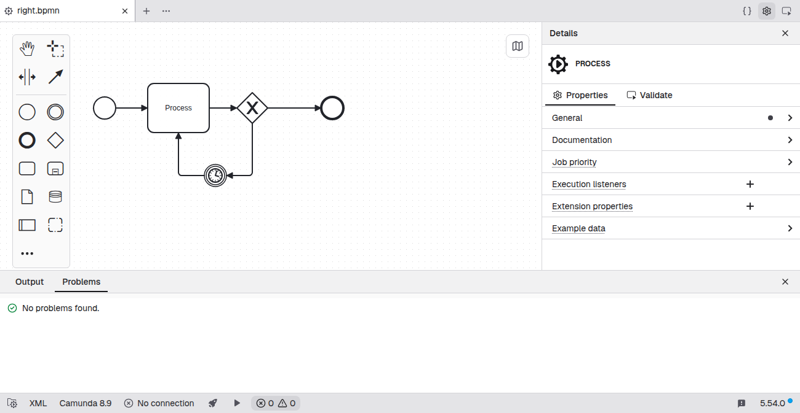
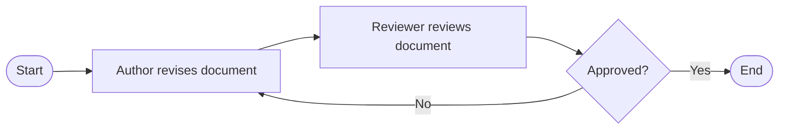

import MarkerGuideline from "@site/src/mdx/MarkerGuideline";

This error occurs when a BPMN model contains an automated loop (without human interaction or external event triggers). It may cause an endless recursion.

This may result in:

- Endless execution
- [Excessive resource usage](../../../../saas/clusters/cluster-capacity.md)

To fix this problem, add a timer, user task, or external event (e.g., message catch) to break the straight-through loop and ensure controlled execution.

## <MarkerGuideline.Invalid /> Straight-through processing loop

## <MarkerGuideline.Valid /> Controlled Loop

## Review loops

A loop is fine when a person completes a task on every pass through it. For example, an author revises a document, a reviewer approves it or returns it, and the author revises it again.

This loop passes the rule because it contains two user tasks. The return from the reviewer goes to the author's **Revise document** task, not back to the reviewer. The reviewer sees the document again only after the author submits the revision.

## References

- [Rule source](https://github.com/camunda/bpmnlint-plugin-camunda-compat/blob/main/rules/camunda-cloud/no-loop.js)
