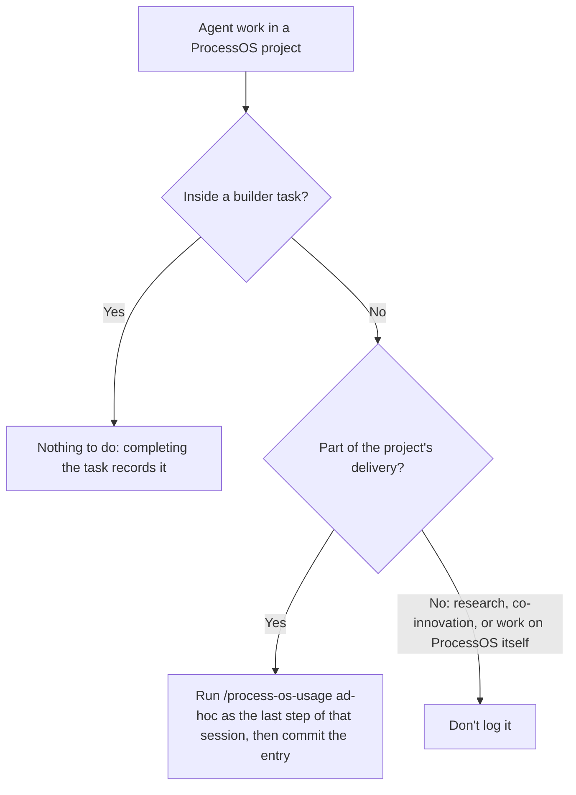

import PageDescription from '@site/src/components/PageDescription';

<PageDescription />

## About

With cost tracking, you can see roughly what each project iteration costs in tokens and USD. The agent that does the work reports its own usage. ProcessOS Harness validates the reports, stores them in your project, and adds them up when you ask for totals.

## What is recorded

ProcessOS Harness stores one usage entry per window of agent work. An entry has one of two kinds:

| Kind    | Covers                                                                                  | Recorded by                                                  |
| ------- | --------------------------------------------------------------------------------------- | ------------------------------------------------------------ |
| `job`   | The window from the activation of a builder task to its completion or failure.          | ProcessOS Harness, automatically.                            |
| `adhoc` | A one-off agent session, or part of one, outside a builder task.                        | You, with the `/process-os-usage` skill.                     |

An entry contains:

- Token counts and an approximate cost in USD, including the usage of subagents the agent dispatched in the window.
- Timestamps, model names, and, where the agent records it, the configured reasoning effort of each model.
- The lifecycle phase of the work, if known.
- The session ID of the agent and an optional builder pseudonym.

An entry never contains prompts, transcript content, real names, or email addresses.

## Where entries are stored

Each entry is one JSON file under `.camunda/usage/`. You commit these files with the rest of your project.

ProcessOS Harness stores no aggregate. It calculates totals from the entry files when you ask for them. Entries recorded on different branches merge as separate files, so they don't create conflicting totals.

Before it records an entry, the agent writes a draft to `.camunda/usage-draft-*.json`. Project initialization adds these drafts to `.gitignore`, so they never end up in a commit.

## Automatic recording per builder task

ProcessOS Harness records one `job` entry for each [builder task](builder-task.md) without any action from you. The entry is stored in the **Record usage** step of task completion and is committed with the task's output. The completion report includes a `Usage:` line.

Each entry counts only the usage inside its own window. If the agent runs several builder tasks in one session, each task gets its own entry, and no stretch of the session is counted twice.

Recording never blocks a builder task. If the agent can't produce a valid entry, the task still completes, and the report states why no usage was stored.

## Record work outside a builder task

Builder tasks record their usage automatically. Log any other agent work for the project yourself, so the totals cover it.

### Project work outside a builder task

**When:** You use the agent for the project outside a builder task, for example to optimize a report or fix a BPMN model after review.

**How:** As the last step of the session that did the work, ask the agent to log the session's usage, or run `/process-os-usage ad-hoc`. Then commit the file the skill writes to `.camunda/usage/`.

The skill supports these arguments:

| Argument                | Description                                                                                                                                                                    |
| ----------------------- | ------------------------------------------------------------------------------------------------------------------------------------------------------------------------------ |
| `--phase <phase>`       | The lifecycle phase of the work: `initialization`, `discovery`, `transformation`, or `implementation`. If you omit it, the phase comes from the builder task active in the checkout, if any. |
| `--since <ISO-8601>`    | The start of the window, for example `2026-11-16T09:00:00Z`. If you omit it, the window is the whole session so far.                                                           |

The skill never asks you for the phase. An entry without a phase appears in the `—` row of the totals.

### Research, co-innovation, and work on ProcessOS itself

**When:** You experiment, for example to try out a model or a prompt, do co-innovation work outside the project's delivery, or work on ProcessOS itself.

**How:** Don't log it. Work you don't log stays out of the totals.

### Do

- Use one session per task, so each entry covers one piece of work.
- Log the session in the session that did the work, before you close it.
- Commit the entry file. The skill doesn't commit it for you.

### Don't

- Don't log a builder task's work manually. It's already recorded.
- Don't log earlier work from a new session. The agent reads only its own current session's usage, so a new session logs only itself.

### Avoid double counting

No stretch of a session is stored twice. The store matches the entries of one session by the agent's session ID.

- If you log the same session again without `--since`, the new entry replaces the session's earlier one-off entry.
- To add only later work beside an earlier entry, set `--since` to the time the earlier entry's window ended.
- If the new window partly overlaps a stored one, the skill asks which of the two start times to use.
- If the session also ran a builder task, the skill logs only the work after the task ended. A one-off entry and a `job` entry of the same session never replace each other.

## View totals

To print the totals by phase and kind, ask the agent what the project has cost so far, or run `/process-os-usage summary`.

The table lists entries, model calls, tokens, wall time, and USD for each phase and kind, plus a grand total. The phase is one of `initialization`, `discovery`, `transformation`, or `implementation`. A `job` entry takes its phase from the skill and mode of the builder task.

If an entry file in `.camunda/usage/` is invalid, the summary fails and names the file instead of printing a total that is too small. Fix or remove the file, and run the summary again.

## Understand the accuracy

The numbers are approximate. Each entry states how the agent obtained its values:

| Field        | Values                                                         | Meaning                                                                                                          |
| ------------ | -------------------------------------------------------------- | ---------------------------------------------------------------------------------------------------------------- |
| `confidence` | `measured`, `estimated`, `unavailable`                         | Whether the agent read the numbers from its own recorded usage, estimated them, or had no data.                  |
| `costBasis`  | `agent-reported`, `list-price-estimate`, or `null`             | Whether the agent recorded the cost itself or estimated it from published list prices. `null` if `costUsd` is `null`. |

If the harness of an agent doesn't record a cost, the agent estimates it from the published list prices of the models and names the prices it used in the entry's `notes` field. If it can't find a price, it leaves the cost `null`.

ProcessOS Harness stores an unknown value as `null`, never as `0`. A total that includes a `null` value is marked `(partial)`, and a total with no known value is marked `unknown`. Read a partial total as a lower bound.

## Privacy

ProcessOS Harness itself never reads an agent's session files: the agent reads its own recorded usage and reports it. No usage data leaves your project.
