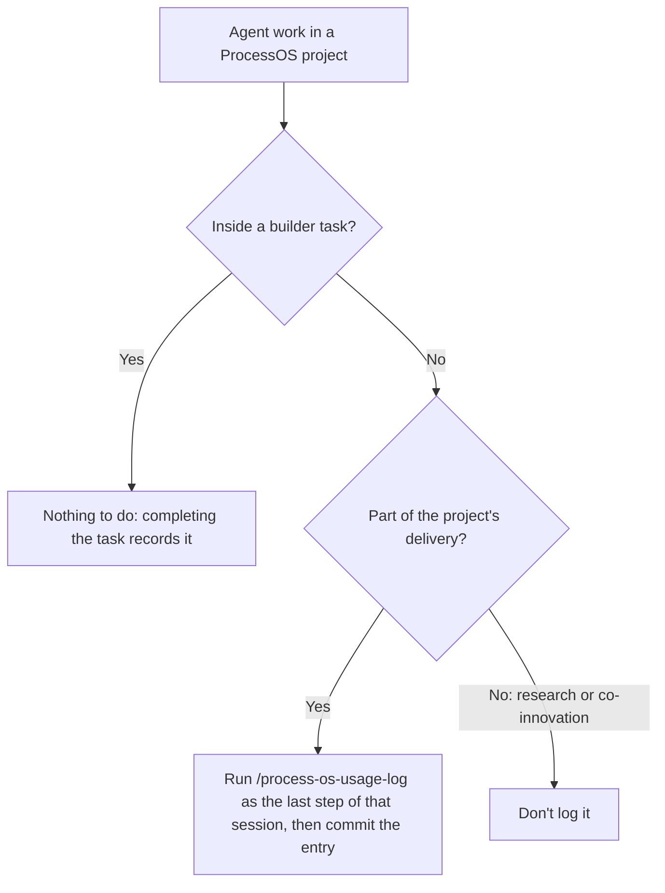

import PageDescription from '@site/src/components/PageDescription';

<PageDescription />

## About

With cost tracking, you can see roughly what each project iteration costs in tokens and USD. The agent that does the work reports its own usage. ProcessOS Harness validates the reports, stores them in your project, and adds them up when you ask for totals.

## What is recorded

ProcessOS Harness stores one usage entry per window of agent work. An entry contains:

- Token counts and an approximate cost in USD.
- Timestamps, model names, and, where the agent records it, the configured reasoning effort of each model.
- The session ID of the agent and an optional builder pseudonym.

An entry never contains prompts, transcript content, real names, or email addresses.

## Where entries are stored

Each entry is one JSON file under `.camunda/usage/`. You commit these files with the rest of your project.

ProcessOS Harness stores no aggregate. It calculates totals from the entry files when you ask for them. Entries recorded on different branches merge as separate files, so they don't create conflicting totals.

## Automatic recording per builder task

ProcessOS Harness records one `job` entry for each [builder task](builder-task.md) without any action from you.

Each entry counts only the usage inside its own window. If the agent runs several builder tasks in one session, each task gets its own entry, and no stretch of the session is counted twice.

## Record work outside a builder task

Builder tasks record their usage automatically. Log any other agent work for the project yourself, so the totals cover it.

### Project work outside a builder task

**When:** You use the agent for the project outside a builder task, for example to optimize a report or fix a BPMN model after review.

**How:** Start a new agent session for the task. As its last step, run `/process-os-usage-log`, confirm the phase, and commit the file it writes to `.camunda/usage/`.

### Research and co-innovation

**When:** You experiment, for example to try out a model or a prompt, or do co-innovation work outside the project's delivery.

**How:** Don't log it. Work you don't log stays out of the totals.

### Do

- Use one session per task.
- Run `/process-os-usage-log` in the session that did the work, before you close it.
- Commit the entry file. The skill doesn't commit it for you.

### Don't

- Don't log a builder task's work manually. It's already recorded.
- Don't log earlier work from a new session. The agent reads only its own current session's usage, so a new session logs only itself.

If you ran builder tasks earlier in the same session, the skill logs only the work after the last one ended. Logging the same session again replaces its earlier entry.

## View totals

To print the totals by phase and kind, run `/process-os-usage-log summary`.

The phase is one of `initialization`, `discovery`, `transformation`, or `implementation`. A job entry takes its phase from the skill of the job. Totals leave out `research` entries unless you include them.

## Understand the accuracy

The numbers are approximate. Each entry states how the agent obtained its values:

| Field        | Values                                                         | Meaning                                                                                                          |
| ------------ | -------------------------------------------------------------- | ---------------------------------------------------------------------------------------------------------------- |
| `confidence` | `measured`, `estimated`, `unavailable`                         | Whether the agent read the numbers from its own recorded usage, estimated them, or had no data.                  |
| `costBasis`  | `agent-reported`, `list-price-estimate`, or `null`             | Whether the agent recorded the cost itself or estimated it from published list prices. `null` if `costUsd` is `null`. |

ProcessOS Harness stores an unknown value as `null`, never as `0`. A total that includes a `null` value is marked `(partial)`. Read it as a lower bound.

## Privacy

ProcessOS Harness itself never reads an agent's session files: the agent reads its own recorded usage and reports it. No usage data leaves your project.
