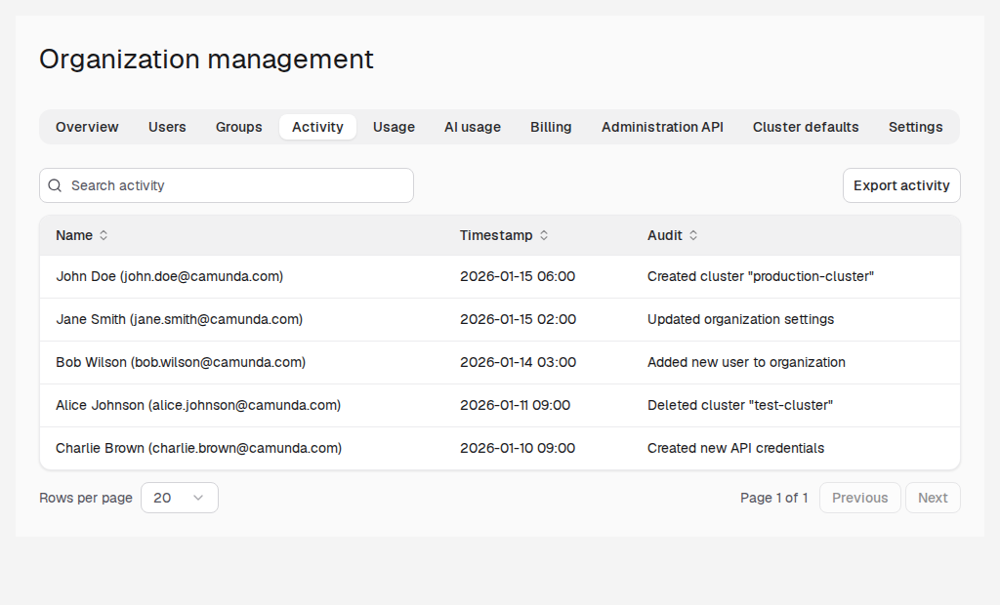

View details of all activity within an organization, such as cluster creation, deletion, updates, and user invitations.

## About organization activity

This feature is only available in SaaS.

By default, an organization has no retention period for activity entries, and Camunda decides when to delete older entries. The organization owner can [set a retention period](#set-activity-retention).

## View activity

To view organization activity:

1. In the left navigation, click **Organization > Manage organization**.
1. Open the **Activity** tab.

On the **Activity** tab, you can click **Export activity** to export the activity record as JSON or CSV.

## Set activity retention

Activity retention sets how long Camunda keeps the entries on the **Activity** tab. Only the organization owner can change it. Other users see the current period on the **Settings** tab.

| Option                                                                                          | Result                                                                    |
| ----------------------------------------------------------------------------------------------- | ------------------------------------------------------------------------- |
| **Not set**                                                                                     | The default. No retention period. Camunda decides when to delete entries. |
| **6 months**, **1 year**, **1.5 years**, **2 years**, **3 years**, **5 years**, or **10 years** | Camunda deletes entries older than the selected period.                   |

Camunda can't restore deleted entries, even if you select a longer period later. If you need older entries for audits or compliance, [export them](#view-activity) before you select a shorter period.

To set the retention period:

1. In the left navigation, click **Organization > Manage organization**.
1. Open the **Settings** tab.
1. Under **Activity retention**, select a period.
1. Click **Save**.
1. If the new period is shorter than the previous one, review the **Delete older Activity entries?** dialog, and click **Delete and save**.

### What happens after you shorten the retention period

When you save a shorter period, Camunda deletes the older entries in a daily job:

- Within two days, Camunda deletes all entries older than the new period.
- After that, Camunda deletes entries every day once they're older than the period.
- Deleted entries no longer show on the **Activity** tab or in exports.
- Everyone in the organization sees a note on the **Activity** tab that older entries are deleted.

A longer period or **Not set** saves without a dialog and deletes no entries.
