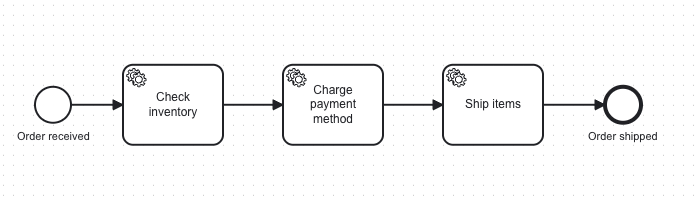
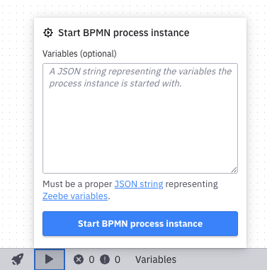
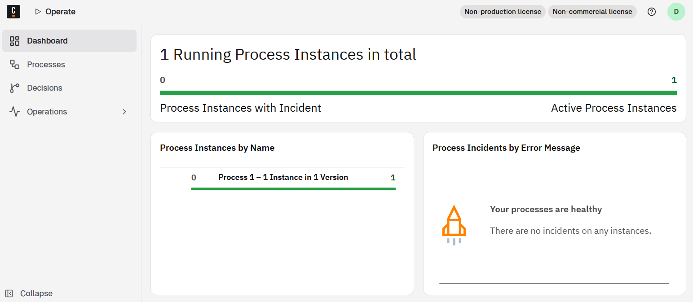

import Tabs from "@theme/Tabs";
import TabItem from "@theme/TabItem";
import PageDescription from '@site/src/components/PageDescription';

<PageDescription />

## About

This guide is tailored for developers who want to implement process automation solutions using Java (Spring), JavaScript (Node.js), Python, or C#. You'll work with a local, self-managed, lightweight Camunda 8 environment.

## Get started with an example project

You will:

- Run Camunda 8 in a local development environment using **Camunda 8 Run**.
- Use the **Desktop Modeler** to deploy and start a business process.
- Run workers written in one of:
  - The **Spring (Java) SDK**,
  - The **Node.js (JavaScript) SDK**,
  - The **Python SDK**, or
  - The **C# SDK**  
    to handle tasks in the process.

## Prerequisites

<Tabs groupId="language" defaultValue="javaspring" values={
[
{ label: 'Java + Spring', value: 'javaspring', },
{ label: 'Node.js', value: 'nodejs', },
{ label: 'Python', value: 'python', },
{ label: 'C#', value: 'csharp', },
] }>
<TabItem value="javaspring">

<ul>
    <li>[JDK 21-26](https://www.oracle.com/de/java/technologies/downloads/)</li>
    <li>[Maven 3](https://maven.apache.org/index.html)</li>
    </ul>
  </TabItem>
  <TabItem value="nodejs">
<ul>
    <li>[Node.js](https://nodejs.org/en) 20+</li>
    <li>NPM 11+</li>
</ul>
  </TabItem>
  <TabItem value="python">
<ul>
    <li>[Python](https://www.python.org/downloads/) 3.10+</li>
    <li>pip</li>
</ul>
  </TabItem>
  <TabItem value="csharp">
<ul>
    <li>[.NET SDK](https://dotnet.microsoft.com/download) 8 or later</li>
</ul>
  </TabItem>
  </Tabs>

## Set up Camunda 8 locally

In this section, you'll set up a local Camunda 8 environment with the following components:

- [Camunda 8 Run](/self-managed/quickstart/developer-quickstart/c8run.md) – A simplified, single-application Camunda configuration for a local development environment.
- [Desktop Modeler](/components/modeler/desktop-modeler/index.md) – An application for modeling BPMN, DMN, and Forms.

<Tabs groupId="local-setup" defaultValue="cli" values={
[
{ label: 'Camunda CLI (recommended)', value: 'cli', },
{ label: 'Manual setup', value: 'manual', },
]}>

<TabItem value="cli">

1. Install the [Camunda CLI](/apis-tools/c8ctl/getting-started.md). It requires [Node.js](https://nodejs.org/en/download) 22.18 or later.

   ```bash
   npm install -g @camunda8/cli
   ```

2. Run the guided setup, and keep **Local cluster** and **Desktop Modeler** selected:

   ```bash
   c8ctl setup
   ```

   The setup downloads and starts Camunda 8 Run and installs Desktop Modeler.

</TabItem>

<TabItem value="manual">

1. Download Camunda 8 Run and Desktop Modeler for your operating system from [Camunda Downloads](/downloads).
2. Extract Camunda 8 Run and [start it](/self-managed/quickstart/developer-quickstart/c8run/install-start.md#install-and-start-camunda-8-run).
3. [Install Desktop Modeler](/components/modeler/desktop-modeler/install-the-modeler.md).

</TabItem>
</Tabs>

## Example project

The example project, located in the `camunda-8-get-started/2-order-process-with-service-workers` directory, contains a BPMN process model that represents a simple e-commerce flow with three service tasks.



The service tasks in the process are executed by [job workers](/reference/glossary.md#job-worker). The `java`, `nodejs`, `python`, and `csharp` directories inside `2-order-process-with-service-workers` contain code for job workers that correspond to this process model.

Clone the [getting started project](https://github.com/camunda/camunda-8-get-started) to get the example project:

```bash
git clone https://github.com/camunda/camunda-8-get-started.git
```

If you don't use Git, [download the project as a ZIP file](https://github.com/camunda/camunda-8-get-started/archive/refs/heads/main.zip), extract it, and rename the extracted `camunda-8-get-started-main` folder to `camunda-8-get-started`.

## Instructions

<ol>
  <li>
    Open Desktop Modeler.
  </li>

  <li>
    In Desktop Modeler, click <b>File > Open File</b>
  </li>

  <li>
  Select `camunda-8-get-started/2-order-process-with-service-workers/bpmn/order-process.bpmn`
  </li>

  <li>
    Click the "Rocket" icon to connect to your Camunda 8 Run instance and deploy the model.
    You can use the pre-configured `c8run (local)` connection.
  </li>

  <li>
    Click the “Play” icon on the bottom toolbar of Desktop Modeler to deploy and start an instance of the process model.

    <p>You do not need to set any variables for the process.</p>

    <p>Optionally, you can set a value for the <code>item</code> variable by pasting in:</p>
    <pre><code>{`{"item": "special widget"}`}</code></pre>

    

  </li>
</ol>

## View the process instance and start job workers

A [process instance](/reference/glossary.md#process-instance) is now running in the engine.

You can view the process instance in **Operate**, the visual operations tool:

1. Navigate to: [http://localhost:8080/operate](http://localhost:8080/operate)
2. Login with the credentials: `demo` / `demo`.

There you will see an active process instance.

:::note
Data needs to sync to Operate, so the process instance may not be visible immediately.

Additionally, when the workers are running, process instances will be completed immediately and further process instances will not appear as active.
:::



Next, start the job workers to allow them to perform the work for the service tasks. The workers are configured to connect to the locally-running engine and retrieve available work for the process instance.

<Tabs groupId="language" defaultValue="javaspring" values={
[
{ label: 'Java + Spring', value: 'javaspring', },
{ label: 'Node.js', value: 'nodejs', },
{ label: 'Python', value: 'python', },
{ label: 'C#', value: 'csharp', },
] }>
<TabItem value="javaspring">

<ol>
<li>
Change into the Spring SDK directory:

```bash
cd camunda-8-get-started/2-order-process-with-service-workers/java
```

      </li>
      <li>
        Start the workers with the command:

```bash
mvn spring-boot:run
```

      </li>
      <li>
        You can stop the application via Ctrl+C.
      </li>
    </ol>

  </TabItem>

  <TabItem value="nodejs">
    <ol>
      <li>
        Change into the Node.js SDK directory:
```bash
cd camunda-8-get-started/2-order-process-with-service-workers/nodejs
```
      </li>
      <li>
        Install dependencies with the command:
```bash
npm i
```
      </li>
      <li>
        Start the workers with the command:
```bash
npm start
```
      </li>
      <li>
        You can stop the application via Ctrl+C.
      </li>
    </ol>
  </TabItem>

  <TabItem value="python">
    <ol>
      <li>
        Change into the Python SDK directory:
```bash
cd camunda-8-get-started/2-order-process-with-service-workers/python
```
      </li>
      <li>
        Create a virtual environment and install dependencies:
```bash
python -m venv .venv
source .venv/bin/activate  # On Windows: .venv\Scripts\activate
pip install -r requirements.txt
```
      </li>
      <li>
        Start the workers with the command:
```bash
python main.py
```
      </li>
      <li>
        You can stop the application via Ctrl+C.
      </li>
    </ol>
  </TabItem>

  <TabItem value="csharp">
    <ol>
      <li>
        Change into the C# SDK directory:
```bash
cd camunda-8-get-started/2-order-process-with-service-workers/csharp
```
      </li>
      <li>
        Start the workers with the command:
```bash
dotnet run
```
      </li>
      <li>
        You can stop the application via Ctrl+C.
      </li>
    </ol>
  </TabItem>
   </Tabs>

The workers start, connect to the engine, and request work. You will see the workers processing the jobs for the process instance.

## Complete!

Navigate back to Operate and verify that your active process instance in Operate has transitioned to completed.

## Summary

You have completed your first process instance by:

1. Running Camunda 8 Run locally.
2. Deploying a process model.
3. Starting a process instance.
4. Completing the service tasks in the process instance using job workers.

## Next steps

To learn more about our SDKs, visit their respective documentation pages:

- Java SDK - [Camunda Java client documentation](/apis-tools/java-client/getting-started.md)
- Spring Boot starter - [Camunda Spring Boot Starter documentation](/apis-tools/camunda-spring-boot-starter/getting-started.md)
- Node.js SDK - [Camunda 8 JavaScript SDK API documentation](https://camunda.github.io/camunda-8-js-sdk/)
- Python SDK - [Python SDK documentation](/apis-tools/python-sdk.md)
- C# SDK - [C# SDK documentation](/apis-tools/csharp-sdk.md)

## Teardown

You can stop Camunda 8 Run:

<Tabs groupId="local-setup" defaultValue="cli" values={
[
{ label: 'Camunda CLI (recommended)', value: 'cli', },
{ label: 'Manual setup', value: 'manual', },
]}>
<TabItem value="cli">

```bash
c8ctl cluster stop
```

</TabItem>
<TabItem value="manual">

[Shut down Camunda 8 Run](/self-managed/quickstart/developer-quickstart/c8run/install-start.md#shut-down-camunda-8-run) from its directory.

</TabItem>
</Tabs>
