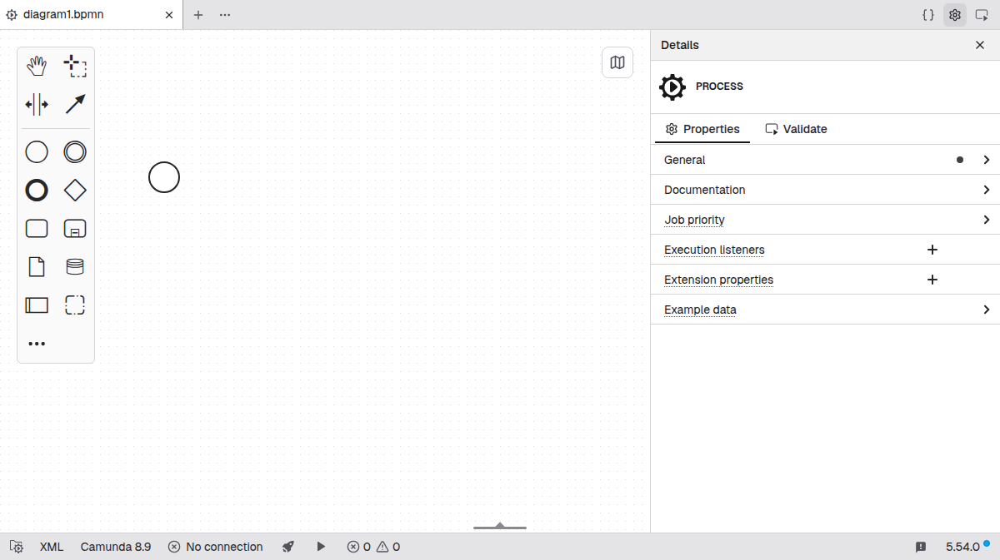

Camunda 7 and 8

Desktop Modeler is a desktop application for modeling BPMN, DMN, and Forms. As part of the Camunda implementation toolkit, it helps you create executable diagrams while working alongside your preferred IDE, integrated into your professional software development environment.

## Features

- Design [BPMN](../bpmn/bpmn.md), [DMN](../dmn/dmn.md), and [Forms](../forms/camunda-forms-reference.md)
- Implement process applications for Camunda 7 and 8
- Deploy and run processes directly from the application
- Validate your diagrams using [configurable lint rules](https://github.com/camunda/camunda-modeler-custom-linter-rules-plugin)
- [Customize](./flags/flags.md) and [extend](./plugins/plugins.md) the application
- Work against the local file system

## Download

Download the app for Windows, Linux, or macOS from the [Camunda downloads page](https://camunda.com/download/modeler/). After downloading, follow the [installation steps](./install-the-modeler.md) to extract the archive and start the application.

> On Windows and Linux you can carry out [additional steps](./install-the-modeler.md#wire-file-associations) to register Modeler as the default editor for BPMN, DMN, and Form files.

## Set up Desktop Modeler

1. [Download and install](./install-the-modeler.md) Desktop Modeler for Windows, Linux, or macOS.
2. Start the application and [model your first diagram](./model-your-first-diagram.md).
3. [Connect to Camunda 8](./connect-to-camunda-8.md) to deploy diagrams and start process instances. By default, Desktop Modeler includes a local Camunda 8 Run connection, so you can start without adding one.

## Resources

- [Report an issue](https://github.com/camunda/camunda-modeler/issues)
- [Source code](https://github.com/camunda/camunda-modeler)
- [Troubleshooting](./troubleshooting.md)
